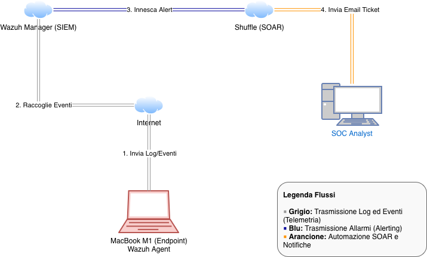
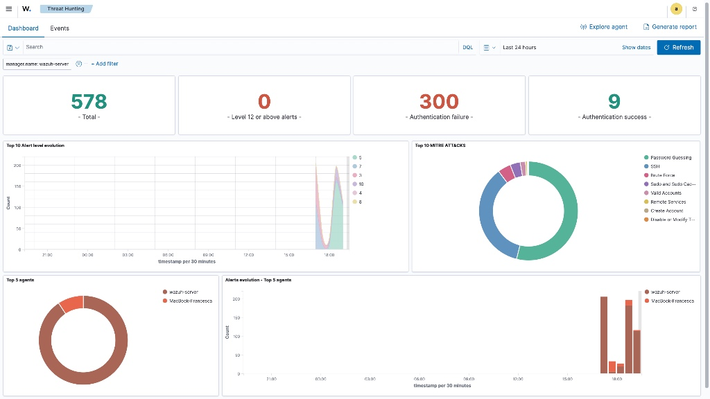
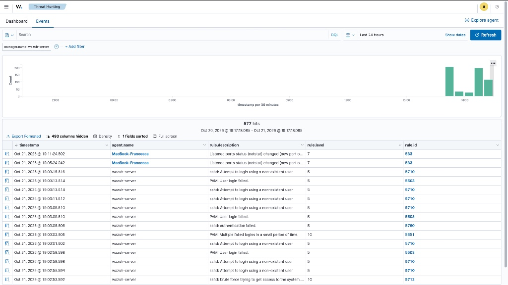
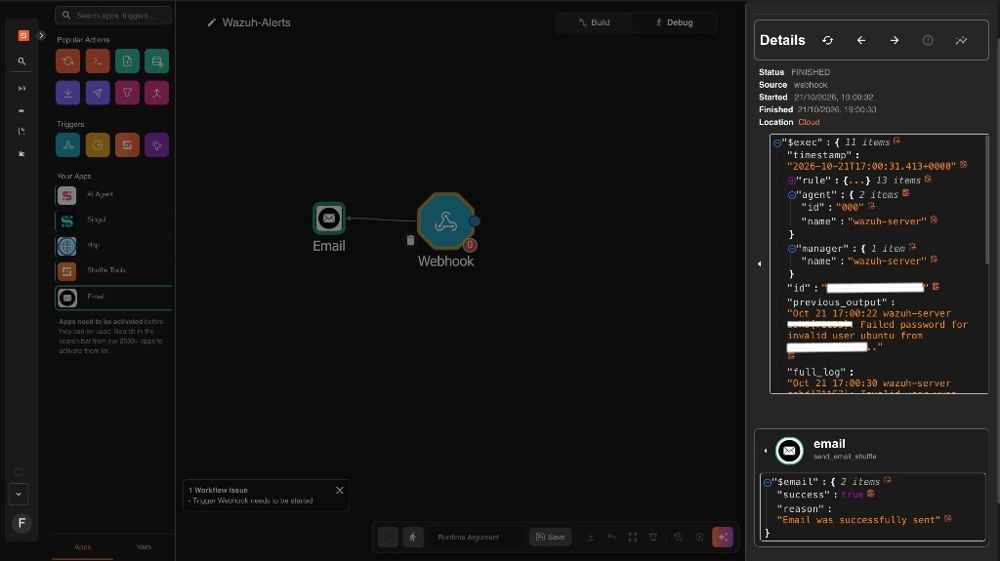
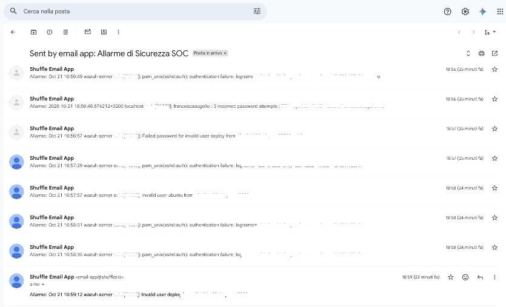

# Home SOC Lab: Real-Time Threat Detection & SOAR Automation (macOS / Cloud)

Home SOC Lab è un progetto pratico di monitoraggio della sicurezza, rilevamento delle minacce e risposta automatizzata, progettato per proteggere un endpoint macOS aziendale (Apple Silicon) tramite un'infrastruttura SIEM in Cloud.

## Obiettivo del Progetto

Progettare e implementare l'intero ciclo operativo di un Security Operations Center (SOC): dall'ingestione della telemetria di un endpoint locale fino all'orchestrazione della risposta automatizzata agli incidenti (SOAR), gestendo sia minacce simulate che attacchi reali dal web.

## Stack Tecnologico

* **Endpoint Monitorato:** MacBook M1 (macOS) con **Wazuh Agent** (Architettura nativa ARM64).
* **Infrastruttura Cloud:** Server **Ubuntu 22.04 LTS** (8GB RAM, 4 vCPU) ospitato su DigitalOcean.
* **SIEM / XDR:** **Wazuh Manager** (All-in-one deployment per aggregazione log, analisi e alerting).
* **SOAR:** **Shuffle** (Automazione flussi di lavoro e notifica incidenti via Webhook).

## Topologia di Rete e Workflow

---

## Fasi dell'Implementazione

### 1. Provisioning Cloud e Deploy del SIEM

Ho optato per un'architettura ibrida, distribuendo il "cervello" del SOC nel Cloud per garantire alta disponibilità e simulare un ambiente realistico.

* Configurazione di un Droplet su DigitalOcean localizzato in Europa per ridurre la latenza.
* Installazione automatizzata dello stack Wazuh (Manager, Indexer, Dashboard).
* Esposizione sicura dell'interfaccia web e tuning del motore di indicizzazione.

### 2. Connessione dell'Endpoint e Telemetria

Piuttosto che utilizzare macchine virtuali locali ad alto consumo di risorse, ho trasformato il mio ambiente di sviluppo principale (MacBook M1) nel target da monitorare.

* Deploy del pacchetto Wazuh Agent per macOS.
* Registrazione dell'agent tramite l'IP pubblico del manager e attivazione del demone di monitoraggio locale.
* Verifica della sincronizzazione dei log di sistema.

### 3. Integrazione SOAR (Automazione della Risposta)

Per ridurre l'alert fatigue e abbattere i tempi di risposta, ho creato una pipeline automatizzata utilizzando Shuffle.

* Sviluppo di un workflow su Shuffle Core.
* Creazione di uno script bash personalizzato in `/var/ossec/integrations/custom-shuffle` sul server Ubuntu per estrarre il payload JSON (`full_log`) dell'alert e instradarlo verso il Webhook di Shuffle.
* Configurazione del modulo Email su Shuffle per inviare notifiche in tempo reale all'analista SOC esclusivamente per allarmi con livello di criticità pari o superiore a 10.

---

## Threat Detection in Azione: Simulazione vs Realtà

Il laboratorio ha testato con successo la kill-chain difensiva contro due diverse tipologie di minaccia, validando sia l'endpoint detection che il monitoraggio del perimetro Cloud.

### Caso A: Simulazione di Privilege Escalation (Endpoint Locale)

Per testare il rilevamento sull'endpoint, ho simulato un attacco di tipo *Brute Force / Privilege Escalation* sul terminale macOS.

* **Vettore:** Esecuzione multipla di comandi `sudo` con password intenzionalmente errate.
* **Rilevamento:** Il modulo PAM del Mac ha registrato l'anomalia. Wazuh ha intercettato 3 tentativi falliti consecutivi innescando la regola `5404` (Livello 10).
* **Risultato:** L'incidente è stato tracciato nella dashboard MITRE ATT&CK sotto la categoria "Password Guessing".

### Caso B: Attacco SSH Brute Force Reale (Cloud Server)

Durante la fase di test, l'esposizione del server Cloud su Internet ha attirato traffico malevolo automatizzato (botnet/scanner). Il SOC ha dimostrato la sua efficacia rilevando e notificando un **attacco reale in corso**.

* **Vettore:** Tentativi ripetuti di accesso SSH non autorizzati da un indirizzo IP esterno.

* **Rilevamento:** Gli attaccanti hanno cercato di forzare il login utilizzando dizionari di utenze comuni, cercando di accedere come utente `ubuntu`, `deploy` e `ro`.

* **Automazione e Notifica:** Shuffle ha processato immediatamente i log di sistema e ha inondato la casella di posta dell'analista con le notifiche in tempo reale dell'attacco, dimostrando l'efficacia del flusso SOAR in uno scenario di produzione.

## Competenze Acquisite & Dimostrate

* Progettazione architetturale SOC e provisioning in ambiente Cloud.
* Configurazione, sviluppo script Bash e troubleshooting di integrazioni API/Webhook.
* Analisi dei log nativi.
* Incident Response, Case Management e Security Orchestration.

---
